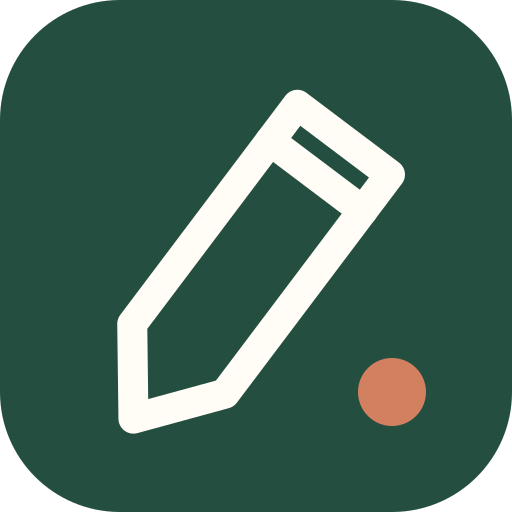

<div align="center">



# Piirrä

**Watch it draw. Find the word.**
A free, offline-friendly game for learning Finnish — in English and Turkish.

**Çizimi izle. Kelimeyi bul.** İngilizce ve Türkçe arayüzlü, ücretsiz bir Fince öğrenme oyunu.

</div>

---

## What is it?

A picture is drawn on screen one stroke at a time. Guess the Finnish word before the drawing is finished. Around that core game there is a whole little Finnish course, from beginner to intermediate:

| | |
|---|---|
| ✏️ **Draw & guess** | 409 illustrated words in 21 topics. Type, pick from four, listen and type, or translate. |
| 🧩 **Sentence lab** | 348 gap-fill sentences tagged by grammar point. |
| 🏋️ **Verb gym** | 78 verbs with full present, past and negative tables. |
| 🎓 **Pocket grammar** | 43 short lessons (EN + TR) with tables, examples and 250 quiz items, plus a mixed *grammar workout*. |
| 💬 **Conversations** | 27 real-life dialogues: café, pharmacy, train station, job interview… |
| 📖 **Phrasebook** | 243 everyday phrases and idioms with flashcards. |
| 🖼️ **Little scenes** | 40 two-picture scenes that practise cases and forms. |
| 🔢 **Numbers** | Generated practice from 0 to 9999. |

### Levels

| Level | Roughly | Words | Focus |
|---|---|---|---|
| Beginner / Başlangıç | A1 | 177 | first words, *olla*, present tense, where things are |
| Elementary / Temel | A2 | 133 | partitive, past tense, plurals, shopping, travel |
| Intermediate / Orta | B1 | 99 | conditional, passive, perfect, work life, opinions |

### Built for calm, focused practice

- Short rounds; the drawing never times out.
- Hints are free — they only make the word come back sooner.
- Spaced repetition: known words come back less often, missed words sooner.
- **No accounts, no ads, no tracking.** Progress lives in your browser; export/import a backup file to move it.
- Works offline after the first visit (installable PWA).
- Light and dark themes, reduced motion, larger text, full keyboard support, on-screen **ä ö å** keys.

### Pronunciation

Pronunciation uses the Web Speech API, so the voice comes from your device. For natural-sounding Finnish use **Microsoft Edge** (Noora / Harri "Natural" voices), **Safari** on iPhone/Mac (Satu) or **Chrome on Android**. If no Finnish voice is installed, Piirrä stays silent instead of reading Finnish with a wrong-language voice.

## Run locally

No build step, no dependencies. Serve the `site/` folder with any static server:

```bash
python -m http.server 8000 -d site
```

Then open http://localhost:8000.

## Deploy to GitHub Pages

1. Push this repository to GitHub (default branch `main`).
2. In **Settings → Pages**, set **Source** to **GitHub Actions**.
3. The workflow in `.github/workflows/pages.yml` publishes `site/` on every push to `main`.

All paths are relative, so the site works from `https://<user>.github.io/<repo>/`.
Live site: **https://nurettincoban.github.io/piirra/**

## Project structure

```
site/
  index.html, manifest.webmanifest, sw.js   app shell, PWA, offline cache
  css/style.css                             design system (light + dark tokens)
  js/main.js                                router and global controls
  js/store.js                               local progress, settings, spaced repetition
  js/i18n.js                                English + Turkish interface strings
  js/art.js                                 SVG rendering and stroke-by-stroke animation
  js/screens/*.js                           one module per screen
  data/*.js                                 all learning content (plain ES modules)
tools/build_icons.py                        rebuilds data/lucide.js from the Lucide package
docs/CONTENT.md                             content schema and quality guide
```

## Contributing

Corrections to the Finnish, Turkish or English are the most valuable contribution — open an issue or a pull request. See [CONTRIBUTING.md](CONTRIBUTING.md) and [docs/CONTENT.md](docs/CONTENT.md).

Adding a new interface language means adding a block to `site/js/i18n.js` and a matching field to the content files.

## Licence

© 2026 Piirrä contributors. Licensed under **[CC BY-NC-SA 4.0](https://creativecommons.org/licenses/by-nc-sa/4.0/)**: free to use, share and adapt for **non-commercial** purposes with attribution, and adaptations must use the same licence. Commercial use is not permitted. See [LICENSE](LICENSE).

Some illustrations are adapted from [Lucide](https://lucide.dev) (ISC, see [LUCIDE-LICENSE](LUCIDE-LICENSE)).
